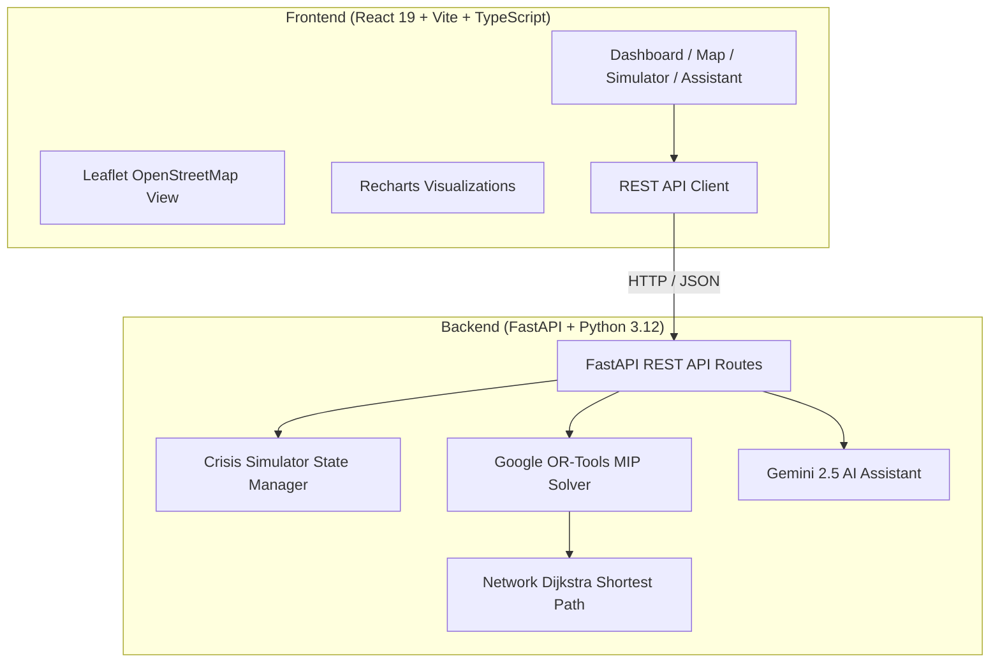

# GRAMMOVE AI
### *The Transportation Network That Refuses to Leave a Student Stranded*

[](https://github.com)
[](https://fastapi.tiangolo.com)
[](https://developers.google.com/optimization)
[](https://react.dev)
[](https://leafletjs.com)
[](https://ai.google.dev)

---

## 1. Problem Statement & Reality
In rural India (such as the Ramanagara, Channapatna, and Kanakapura taluks), thousands of students rely on sparse, rigid public bus schedules to reach government polytechnics, pre-university colleges, and engineering institutes. 

When a single government bus breaks down, or a monsoon culvert bridge closes, or exam day triggers a +40% surge:
- Rural students are left completely stranded on village roads.
- Students miss crucial semester examinations, diploma practicals, and morning classes.
- Existing bus systems operate in silos without dynamic mutual aid or tactical re-dispatching of nearby private minibuses and shared auto-rickshaws.

---

## 2. Product Vision & Solution
**GRAMMOVE AI** answers the foundational operational question:
> *"Given available government buses, private minibuses, shared autos, student locations, road conditions, vehicle capacities, and arrival deadlines, what is the best possible transportation arrangement right now?"*

The system monitors live network telemetry, detects disruptions instantly, and executes **Google OR-Tools Mixed-Integer Linear Programming (MIP)** to dynamically reallocate stranded students to alternative fleet units with **strict mathematical capacity and deadline constraints**.

---

## 3. Core Modules & Capabilities

### A. Live Mobility Dashboard
- Real-time KPI metric cards: Total Demand (210+ students), Fleet Deployment (13 active units), Seat Occupancy, Stranded Students, and Transit Coverage %.
- Dual interactive analytics:
  - **Village Demand vs. Transported vs. Stranded** stacked bar chart.
  - **Fleet Category Capacity Breakdown** (Govt Buses, Minibuses, Shared Autos).
- Live rural departure board with real-time ETAs and route progress.
- Quick Crisis Trigger bar for instant demonstration.

### B. Rural Network Map
- Built with **Leaflet & OpenStreetMap**, centered on Karnataka's Ramanagara rural education corridor.
- Displays 8 feeder villages (Doddamallur, Byramangala, Harohalli, Kailancha, Akkur, Vibhutikere, Sugganahalli, Maralawadi) and 4 major college hubs (Ramanagara Govt Polytechnic, Channapatna ITI, Bidadi Tech Academy, Kanakapura Medical).
- Visual status indicators:
  - Normal open roads (slate).
  - Closed flooded roads / bridges (bold red dashed).
  - Disrupted vehicle locations (pulsing red icons).
  - **Dynamic AI Rescue Routes (pulsing emerald glow lines)** with clickable manifests.
- Multi-layer toggle controls (Vehicles, Villages, Colleges, Roads, Rescue Routes).

### C. Student Management
- 210+ synthetic student records with South Indian rural names, origin villages, destination colleges, pickup times (07:00–07:30 AM), and arrival deadlines (08:45–09:00 AM).
- Real-time status tracking: `Assigned`, `Rescued`, `Stranded`, `Delayed`, `Unserved`.
- Searchable and filterable student directory with status and college filters.

### D. Fleet Management
- Multi-tiered multimodal fleet:
  - **KSRTC Government Buses** (50–55 capacity backbone).
  - **Private Minibuses & MaxiCabs** (20–24 capacity secondary fleet).
  - **Gramina Mitra Shared Autos** (8 capacity rapid tactical rescue units).
- Driver contact information, capacity vs. occupancy progress gauges, live locations, and status controls (Available, En Route, Breakdown, Assigned Rescue).
- Prevents vehicle overcapacity strictly through mathematical upper bounds.

### E. AI Dynamic Rescue Engine (OR-Tools MIP)
- **8-Stage Execution Pipeline**:
  1. *Disruption Triage*: Isolates affected students.
  2. *Fleet Telemetry*: Polls nearby vehicles for spare capacity.
  3. *Capacity Audit*: Calculates remaining seats per vehicle.
  4. *Destination Clustering*: Groups students by compatible college corridors.
  5. *OR-Tools Optimization*: Solves Integer Linear Program.
  6. *Route Generation*: Builds replacement routes bypassing closed roads.
  7. *Triage Verification*: Flags any unserved students if capacity is exceeded.
  8. *Dispatch Manifest*: Outputs final driver instructions and arrival ETAs.

### F. Transportation Crisis Simulator
Interactive sandbox with 5 realistic crisis presets + granular manual controls:
1. **Morning Rush Bus Breakdown**: KSRTC Bus KA-42-F-1024 breaks down at Byramangala with 48 students.
2. **Monsoon Culvert Road Closure**: SH-17 Kailancha Bridge blocked, forcing detour.
3. **Exam Day +40% Surge**: 81+ unexpected extra students appear at rural stands.
4. **Dual Fleet Breakdown Crisis**: Simultaneous failure of BUS-101 and BUS-103.
5. **Highway Construction Gridlock**: +35 minute delay on Old Bangalore-Mysuru Section.
6. **Custom Sandbox**: Toggle breakdown on any vehicle, block any road, or adjust demand sliders.

> **Every action triggers actual recalculation with Google OR-Tools in milliseconds.**

### G. AI Travel Assistant (Powered by Gemini)
- Natural language conversational interface grounded in real-time system state.
- Answers canonical questions:
  - *"My bus broke down. How can I reach college?"*
  - *"Which alternative vehicle can I take?"*
  - *"Which village has the highest transportation shortage?"*
  - *"How many students are affected by this disruption?"*
- Powered by **Google Gemini 2.5 Flash** when `GEMINI_API_KEY` is provided, with an intelligent deterministic reasoning fallback when offline or without an API key.

---

## 4. Technical Architecture



---

## 5. Mathematical Optimization Formulation

The dynamic rescue problem is formulated as a Mixed-Integer Linear Program (MIP):

### Decision Variables:
- $x_{s, v} \in \{0, 1\}$: 1 if student $s$ is assigned to vehicle $v$, 0 otherwise.
- $y_v \in \{0, 1\}$: 1 if vehicle $v$ is deployed for rescue service, 0 otherwise.

### Objective Function:
$$\max \sum_{s \in S} \sum_{v \in V} \left( W_{\text{base}} \cdot x_{s, v} + W_{\text{stranded}} \cdot \mathbb{I}(s \in \text{Stranded}) - \alpha \cdot \text{Time}_{s, v} \right) - \sum_{v \in V} \beta \cdot y_v$$

Where:
- $W_{\text{base}} = 1000$ (maximizing students transported).
- $W_{\text{stranded}} = 500$ (emergency priority to rescue students stranded mid-route).
- $\alpha = 0.2$ (penalty per minute of travel delay).
- $\beta = 15$ (penalty against deploying unnecessary deadhead vehicles).

### Hard Constraints:
1. **Strict Vehicle Capacity**:
   $$\sum_{s \in S} x_{s, v} \le \text{Capacity}_v \cdot y_v \quad \forall v \in V$$
2. **Single Assignment**:
   $$\sum_{v \in V} x_{s, v} \le 1 \quad \forall s \in S$$
3. **Availability & Breakdown Exclusions**:
   $$y_v = 0 \quad \forall v \text{ with status} \in \{\text{BREAKDOWN}, \text{MAINTENANCE}\}$$
4. **Road Closure Avoidance**:
   $$\text{Path}(v \to \text{Origin}(s) \to \text{Destination}(s)) \cap E_{\text{closed}} = \emptyset$$
5. **Deadline Feasibility**:
   $$\text{ETA}_{s, v} \le \text{Deadline}(s)$$

---

## 6. Setup & Execution Instructions

### Prerequisites
- Python 3.11 or 3.12 (`py -3.12` or `python`)
- Node.js v18+ and npm

### Quick Start (One Command)

#### Windows:
```powershell
# In PowerShell:
.\start.ps1
```
Or start backend and frontend in separate terminals:

**Terminal 1 (Backend):**
```powershell
.\venv\Scripts\activate
uvicorn backend.app:app --host 127.0.0.1 --port 8000 --reload
```

**Terminal 2 (Frontend):**
```powershell
cd frontend
npm run dev
```

Open your browser at: **`http://localhost:5173/`**

---

## 7. Verification & Testing

To run the automated end-to-end verification suite:
```powershell
.\venv\Scripts\python.exe test_system.py
```
This tests:
1. Health check & baseline network initialization.
2. Bus breakdown simulation & OR-Tools recovery (achieving 100% coverage via 8 alternative units).
3. Road closure simulation & detour re-computation.
4. +40% exam day demand surge handling.
5. Multi-breakdown fleet emergency triage.
6. AI Travel Assistant Q&A response verification.

---

## 8. License
Developed for the Prompt Battle Hackathon. Open source for educational transit modernization.
